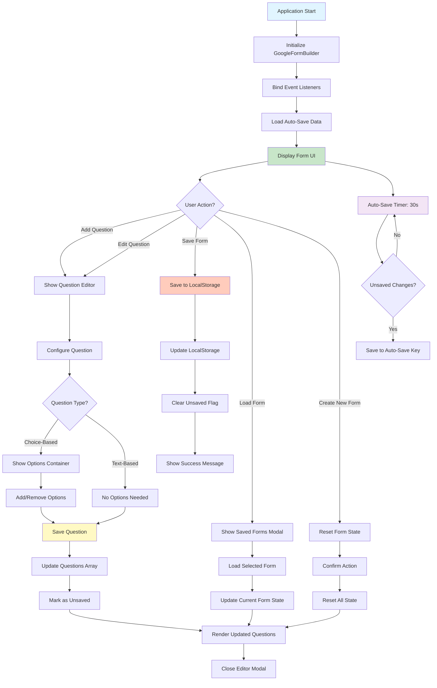

# 📝 Google Form Builder

A powerful, browser-based form builder application that mimics Google Forms functionality. Create, edit, and manage dynamic forms with multiple question types, all within your browser using modern web technologies.


---

## 🎥 Demo Video


---

## 🚀 Overview

This application provides a complete form building solution with an intuitive interface for creating dynamic surveys and forms. Users can add various question types, customize form titles and descriptions, and save their work locally with auto-save functionality.

### Key Features

- ✨ **Multiple Question Types**: Short Answer, Paragraph, Multiple Choice, Checkboxes, and Dropdown
- 💾 **Local Storage**: Save and load forms from browser's localStorage
- 🔄 **Auto-Save**: Automatic saving every 30 seconds to prevent data loss
- ✏️ **Live Editing**: Edit form title, description, and questions in real-time
- 🗑️ **Question Management**: Add, edit, and delete questions with ease
- ⚡ **Required Fields**: Mark questions as required
- 📱 **Responsive Design**: Works seamlessly on desktop and mobile devices

---

## 🛠️ Technologies Used

### Frontend Technologies

| Technology | Version | Purpose |
|------------|---------|---------|
| **HTML5** | Latest | Structure and semantic markup |
| **CSS3** | Latest | Styling and responsive design |
| **JavaScript (ES6+)** | Latest | Application logic and interactivity |
| **LocalStorage API** | Native | Client-side data persistence |

### Core Libraries & APIs

- **Vanilla JavaScript**: No external dependencies, pure JavaScript implementation
- **DOM API**: For dynamic content manipulation
- **LocalStorage API**: For form persistence
- **CSS Grid & Flexbox**: Modern layout techniques

### Browser Compatibility

- ✅ Chrome (Latest)
- ✅ Firefox (Latest)
- ✅ Safari (Latest)
- ✅ Edge (Latest)

---

## 🏗️ Architecture

### Project Structure

```
googleform/
│
├── index.html          # Main HTML structure
├── script.js           # Core application logic (GoogleFormBuilder class)
├── style.css           # Styling and responsive design
└── README.md           # Project documentation
```

### Component Architecture

```
┌─────────────────────────────────────────────────────────────┐
│                    GoogleFormBuilder                         │
│                      (Main Class)                            │
└─────────────────────────────────────────────────────────────┘
                            │
        ┌───────────────────┼───────────────────┐
        │                   │                   │
┌───────▼────────┐  ┌───────▼────────┐  ┌───────▼────────┐
│  Form State    │  │  UI Rendering  │  │  Data Persist  │
│  Management    │  │                │  │                │
├───────────────┤  ├───────────────┤  ├───────────────┤
│ • currentForm  │  │ • renderForm() │  │ • saveForm()   │
│ • questions[]  │  │ • renderQues() │  │ • loadForm()   │
│ • unsavedFlag  │  │ • createQues() │  │ • autoSave()   │
└───────────────┘  └───────────────┘  └───────────────┘
```

### Class Structure

#### `GoogleFormBuilder` Class

```javascript
GoogleFormBuilder
├── Properties
│   ├── currentForm (Object)
│   ├── currentEditingQuestion (Object|null)
│   ├── questionCounter (Number)
│   └── unsavedChanges (Boolean)
│
├── Core Methods
│   ├── init()                    # Initialize application
│   ├── bindEvents()              # Event listener setup
│   ├── renderForm()              # Render form UI
│   └── renderQuestions()         # Render questions list
│
├── Question Management
│   ├── addNewQuestion()          # Create new question
│   ├── editQuestion()            # Edit existing question
│   ├── saveQuestion()            # Save question changes
│   ├── deleteQuestion()          # Remove question
│   └── handleQuestionTypeChange() # Update UI based on type
│
├── Form Management
│   ├── createNewForm()           # Reset to new form
│   ├── saveForm()                # Save to localStorage
│   ├── loadForm()                # Load from localStorage
│   └── deleteForm()              # Remove saved form
│
└── Utility Methods
    ├── generateId()              # Generate unique IDs
    ├── markUnsaved()             # Update unsaved flag
    ├── updateSaveStatus()        # Update UI status
    ├── autoSave()                # Periodic auto-save
    └── loadAutoSave()            # Restore auto-saved data
```

### Data Model

#### Form Object Structure

```javascript
{
  id: "form_1234567890_abc123",
  title: "Form Title",
  description: "Form Description",
  questions: [
    {
      id: "question_1234567890_xyz789",
      type: "multipleChoice",  // shortAnswer | paragraph | multipleChoice | checkboxes | dropdown
      title: "Question Text",
      options: ["Option 1", "Option 2"],  // For choice-based questions
      required: false,
      order: 0
    }
  ],
  createdAt: "2024-01-01T00:00:00.000Z",
  updatedAt: "2024-01-01T00:00:00.000Z"
}
```

---

## 🔄 Application Flow

### Flow Chart



### User Interaction Flow

#### 1. **Form Creation Flow**

```
User Clicks "New Form"
    ↓
Confirm Unsaved Changes (if any)
    ↓
Reset Form State
    ↓
Clear Questions Array
    ↓
Update UI
```

#### 2. **Question Addition Flow**

```
User Clicks "Add Question"
    ↓
Create Default Question Object
    ↓
Add to Questions Array
    ↓
Render Question Preview
    ↓
Open Question Editor Modal
    ↓
User Configures Question
    ↓
Save Question
    ↓
Update Questions Array
    ↓
Re-render Questions
```

#### 3. **Form Saving Flow**

```
User Clicks "Save Form"
    ↓
Update Form Timestamp
    ↓
Get Saved Forms from LocalStorage
    ↓
Check if Form Exists
    ↓
Update or Add Form
    ↓
Save to LocalStorage
    ↓
Clear Unsaved Flag
    ↓
Show Success Message
```

#### 4. **Auto-Save Flow**

```
Every 30 Seconds
    ↓
Check for Unsaved Changes
    ↓
If Unsaved && Questions Exist
    ↓
Save to Auto-Save Key
    ↓
(localStorage: 'autoSave_' + formId)
```

#### 5. **Form Loading Flow**

```
User Clicks "Load Form"
    ↓
Retrieve All Saved Forms
    ↓
Display Forms List in Modal
    ↓
User Selects Form
    ↓
Confirm Unsaved Changes (if any)
    ↓
Load Form Data
    ↓
Update Current Form State
    ↓
Render Form
    ↓
Close Modal
```

---

## 📊 Question Types & Features

### Supported Question Types

| Type | Description | Options Required |
|------|-------------|------------------|
| **Short Answer** | Single-line text input | ❌ No |
| **Paragraph** | Multi-line text area | ❌ No |
| **Multiple Choice** | Radio button selection | ✅ Yes |
| **Checkboxes** | Multiple selections allowed | ✅ Yes |
| **Dropdown** | Single selection from dropdown | ✅ Yes |

### Question Properties

- **Title**: Question text (required)
- **Type**: Question type (required)
- **Options**: Available choices (for choice-based types)
- **Required**: Boolean flag for mandatory questions
- **Order**: Sequential position in form

---

## 🎨 UI Components

### Main Interface

1. **Header Bar**
   - Action buttons (New, Save, Load)
   - Save status indicator

2. **Form Title Section**
   - Editable title (contenteditable)
   - Editable description

3. **Questions Container**
   - Dynamic question cards
   - Edit/Delete buttons
   - Question type indicators

4. **Question Editor Modal**
   - Title input
   - Type selector
   - Options manager (for choice types)
   - Required checkbox

5. **Load Form Modal**
   - List of saved forms
   - Form metadata display
   - Load/Delete actions

---

## 💾 Data Persistence

### LocalStorage Structure

```javascript
// Saved Forms
localStorage.setItem('googleForms', JSON.stringify([
  {
    id: "form_123...",
    title: "My Form",
    // ... form object
  }
]));

// Auto-Save (per form)
localStorage.setItem('autoSave_' + formId, JSON.stringify(formObject));
```

### Storage Keys

- `googleForms`: Array of all saved forms
- `autoSave_{formId}`: Temporary auto-save for specific form

---

## 🔐 Key Design Patterns

### 1. **Singleton Pattern**
- Single instance of `GoogleFormBuilder` class
- Global `formBuilder` variable

### 2. **Event-Driven Architecture**
- All user interactions handled via event listeners
- Decoupled UI and business logic

### 3. **MVC-like Separation**
- **Model**: `currentForm` object structure
- **View**: HTML/DOM manipulation methods
- **Controller**: Event handlers and business logic

### 4. **Observer Pattern**
- Auto-save timer observes state changes
- UI updates reactively based on state

---

## 🚀 Getting Started

### Prerequisites

- Modern web browser (Chrome, Firefox, Safari, Edge)
- No build tools or package managers required

### Installation

1. Clone or download the repository
2. Open `index.html` in your web browser
3. Start building forms!

### Usage

1. **Create a New Form**
   - Click "New Form" to start fresh

2. **Edit Form Title**
   - Click on "Untitled Form" and type your title
   - Edit description similarly

3. **Add Questions**
   - Click "Add Question" button
   - Configure question in the modal
   - Save to add to form

4. **Save Your Form**
   - Click "Save Form" to persist locally
   - Forms are saved in browser's localStorage

5. **Load Saved Forms**
   - Click "Load Form" to view all saved forms
   - Select a form to edit

---

## 📝 Code Highlights

### Key Functions

#### Form Rendering
```javascript
renderQuestions() {
    // Dynamically creates question elements
    // Renders all questions from currentForm.questions array
}
```

#### Question Type Handler
```javascript
handleQuestionTypeChange(type) {
    // Shows/hides options container based on question type
    // Toggles UI elements dynamically
}
```

#### Auto-Save Mechanism
```javascript
autoSave() {
    // Runs every 30 seconds
    // Saves to temporary localStorage key
    // Preserves work in case of accidental closure
}
```

---

## 🎯 Future Enhancements

Potential features for future versions:

- [ ] Export forms to JSON/PDF
- [ ] Form preview mode
- [ ] Drag-and-drop question reordering
- [ ] Form validation rules
- [ ] Conditional logic
- [ ] Form sharing via URL
- [ ] Response collection
- [ ] Analytics dashboard

---

## 📄 License

This project is open source and available under the [MIT License](LICENSE).

---

## 👨‍💻 Development

### Project Status

✅ **Fully Functional** - All core features implemented and tested

### Browser Storage

- **Storage Limit**: ~5-10MB per domain (browser dependent)
- **Persistence**: Data persists until browser data is cleared
- **Portability**: Forms are saved per browser/device

---

## 🤝 Contributing

Contributions, issues, and feature requests are welcome!

---

## 📧 Contact

For questions or support, please open an issue in the repository.

---

<div align="center">

**Built with ❤️ using Vanilla JavaScript**

⭐ **Star this repo if you find it helpful!** ⭐

</div>

# googleform
